# Desert Command

A team-based online game of the Western Desert campaign, 1940–43. It's a digital take on the classic monster wargame's staff system, and the computer does the bookkeeping.

- **Two sides, up to five players each:** Commander-in-Chief, Logistics, Rear Area, Air and Front-line commanders. Empty seats fall to the C-in-C, or to anyone on that side.
- **One player hosts** from the Windows app. A Cloudflare quick tunnel gives the host an `https://….trycloudflare.com` link, and everyone else joins with the app or any web browser. No port forwarding and no Cloudflare account are needed.
- **Simultaneous staff planning.** Each stage of the sequence of play belongs to one role, both sides plan at once, and the stage resolves when both have submitted.
- **Fog of war per side.** The host runs the authoritative game, so clients only ever receive what their side can see.
- **Campaigns autosave** on the host's machine after every action. Continue a campaign from the launcher.

## Screenshots

**The whole board:** all five map sections, from el Agheila to the Nile, digitised from the scanned map sheets, with the coast road traced through its towns.
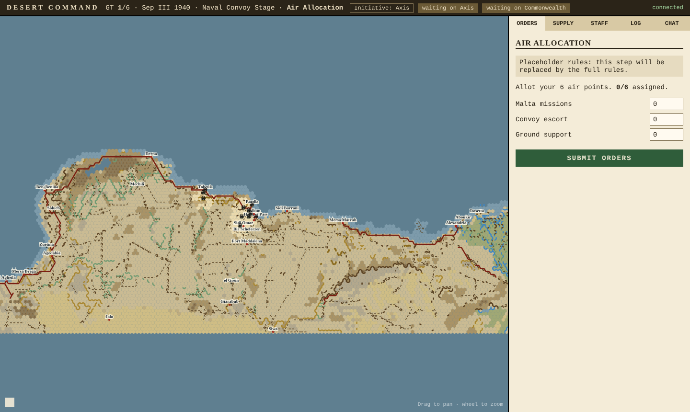

**The frontier, September 1940:** the Italian 10th Army at Bardia, Sollum and Sidi Omar facing the 7th Support Group at Halfaya, set up from the scenario's deployment hexes.
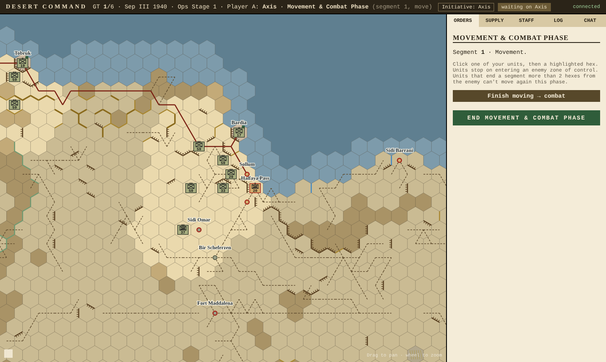

**Movement:** the 1st Libyan Division is selected. Each hex shows the capability points to reach it, using the Terrain Effects Chart. Red hexes are enemy zones of control, where the unit must stop, and orange hexes cost more than the unit's allowance (it can still go, but loses cohesion).
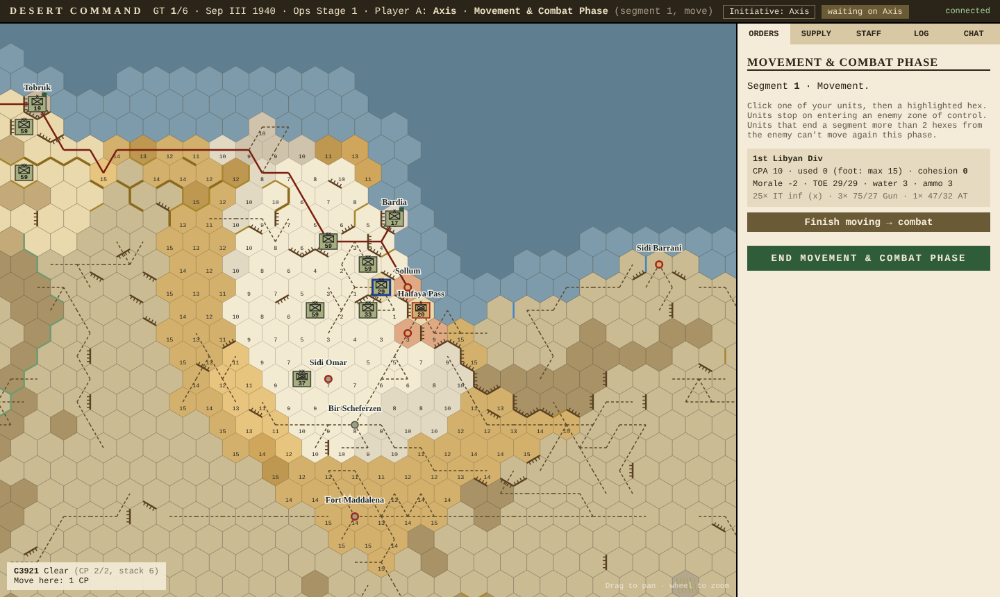

**Reaction:** when the Italians close in, the Commonwealth front-line commander gets the chance to pull motorised units back, mid-way through the Axis turn.
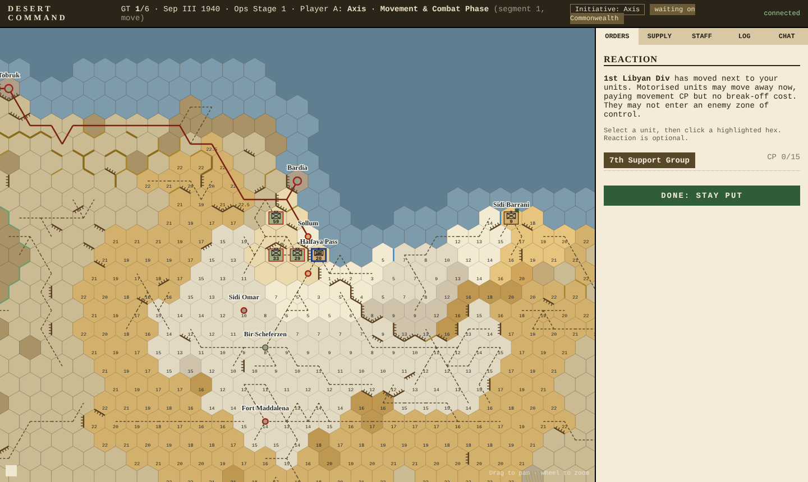

**Under attack:** the defender chooses whether the guns go Forward or Back, what the tanks do, and which units retreat before the assault.
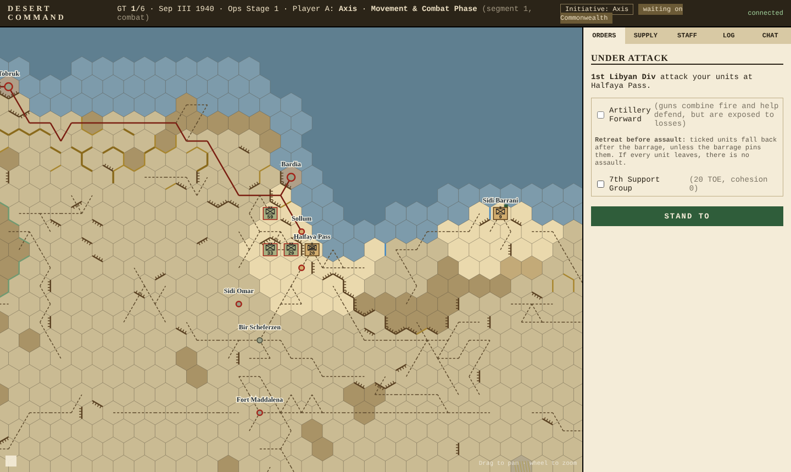

**Combat:** barrage, then anti-armour fire, then morale and close assault, with every die roll reported.
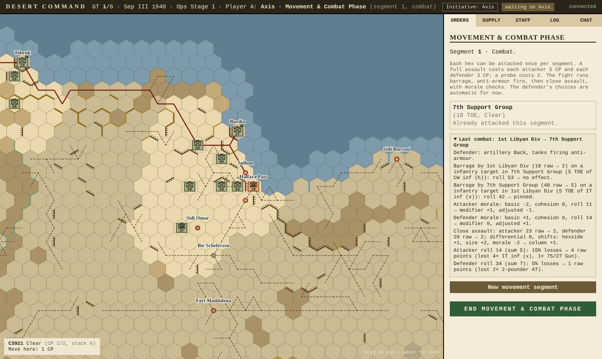

**The other side's view:** the Commonwealth staff sees only what its units can see, plus the log of fighting it took part in.
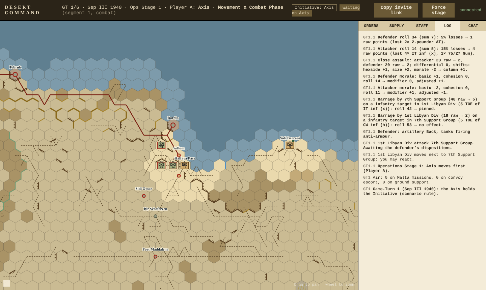

| | |
|---|---|
| 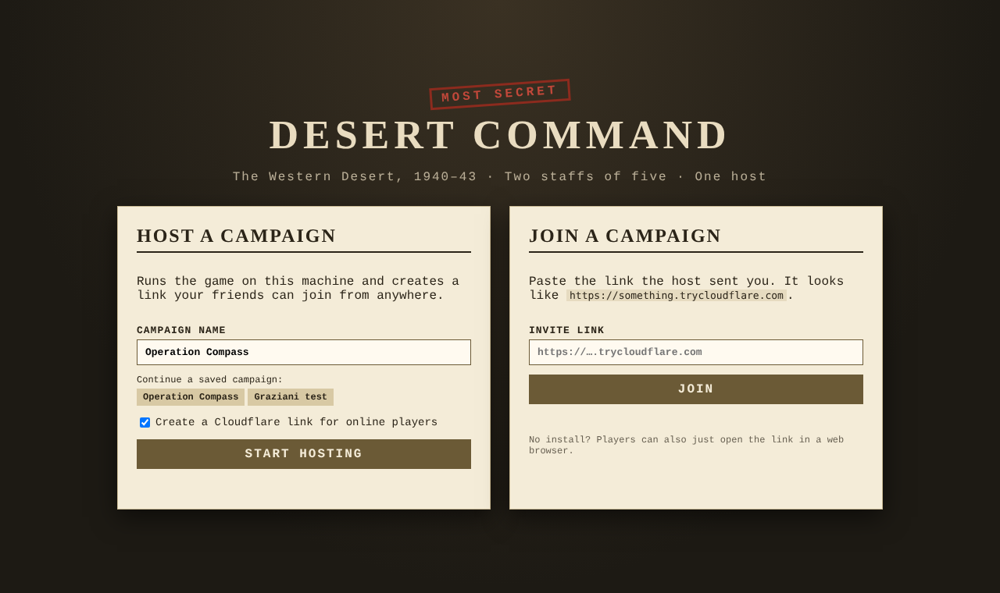 **Launcher:** host a campaign (with a Cloudflare link) or join one | 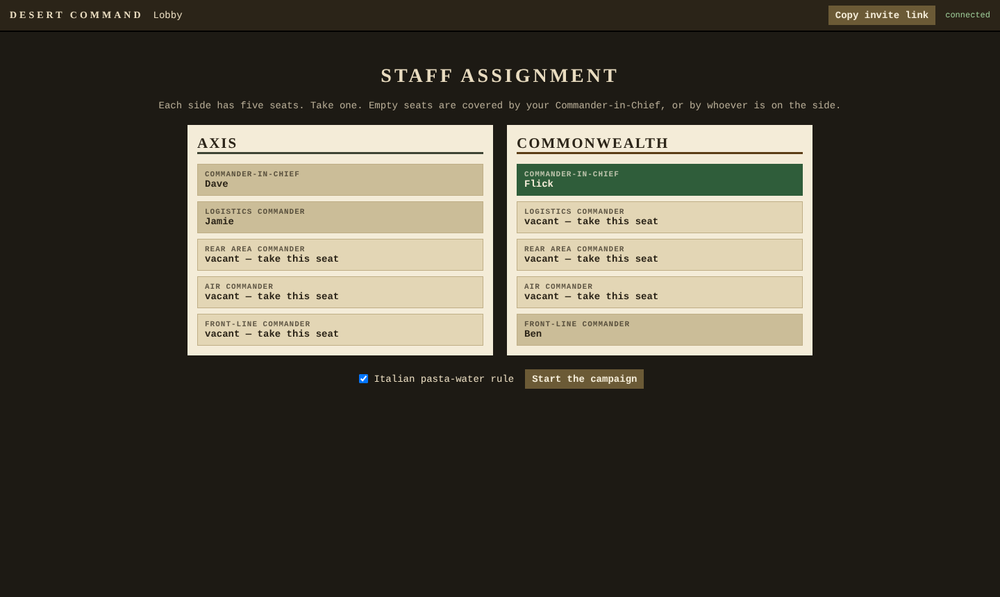 **Staff assignment:** five seats per side |
| 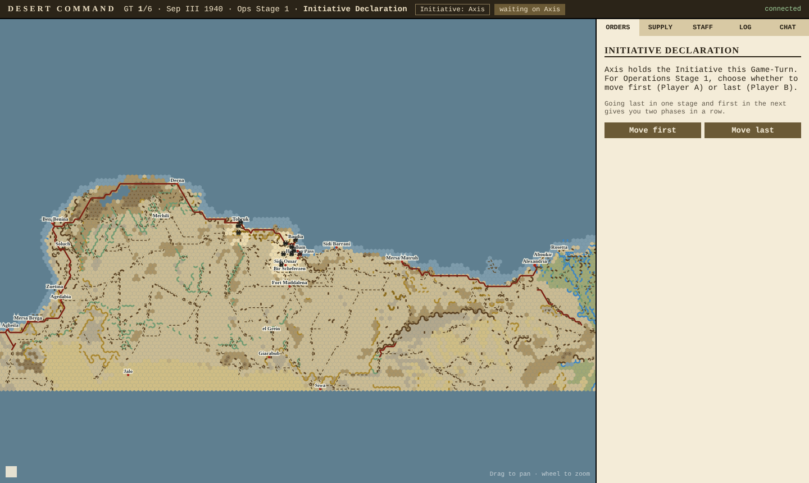 **Initiative:** the holder chooses to move first or last in each Operations Stage | 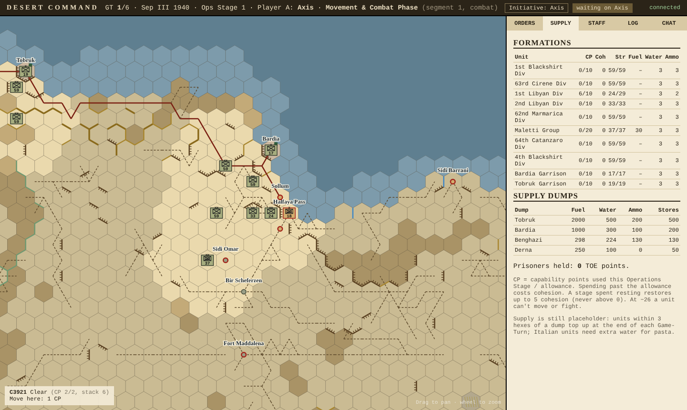 **Formations:** capability points, cohesion, TOE and supplies |

## Status

The real Land Game turn structure is in: initiative, Operations Stages with Player A and Player B, capability points and cohesion, the full Terrain Effects Chart, continual movement, stacking and zones of control. Land combat is in too: barrage, anti-armour fire and close assault with morale, using the real result tables and weapon ratings. The game is played on the full board (sections A–E) with the board's hex numbers, and the Graziani's Offensive setup uses the real deployment hexes. Supply and air are still placeholders. See **[docs/RULES-STATUS.md](docs/RULES-STATUS.md)** for the section-by-section checklist.

## Download

Every push to `main` builds the Windows installer, a portable exe, and a universal Mac app (runs natively on Intel and Apple Silicon M-series Macs). You'll find them under **Actions → latest run → Artifacts**. Tagging a version (`git tag v0.1.0 && git push --tags`) publishes them as a GitHub Release.

### First launch on a Mac

The app isn't signed with an Apple developer certificate, so macOS blocks it the first time. Drag it into Applications, then either right-click it → **Open** → **Open**, or run:

```bash
xattr -cr "/Applications/Desert Command.app"
```

## Develop

```bash
npm install
npm test                      # headless multiplayer test
npm run server                # host without Electron, at http://127.0.0.1:47430
npm start                     # run the desktop app
node scripts/fetch-cloudflared.mjs && npm run dist          # Windows exe
node scripts/fetch-cloudflared.mjs mac && npm run dist:mac  # Mac app
```

## Layout

| Path | What it is |
|---|---|
| `src/main/` | Electron shell: launcher, hosting, Cloudflare tunnel |
| `src/server/` | Game host: HTTP + WebSocket server, rules engine |
| `src/shared/` | Hex maths and scenario data used by both server and client |
| `src/client/` | The game UI (works in the app or a browser) |
| `src/launcher/` | Host / Join screen |

## Note on the rules

Game mechanics aren't protected, but rulebook text, map art and counter designs are. This repo contains only original code, wording and art. Do not commit rulebooks or scans (`*.pdf` is git-ignored).
